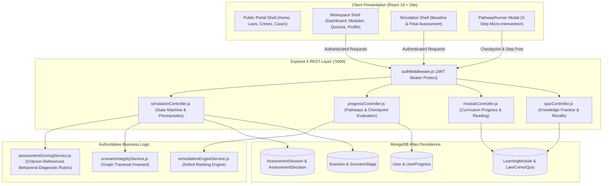
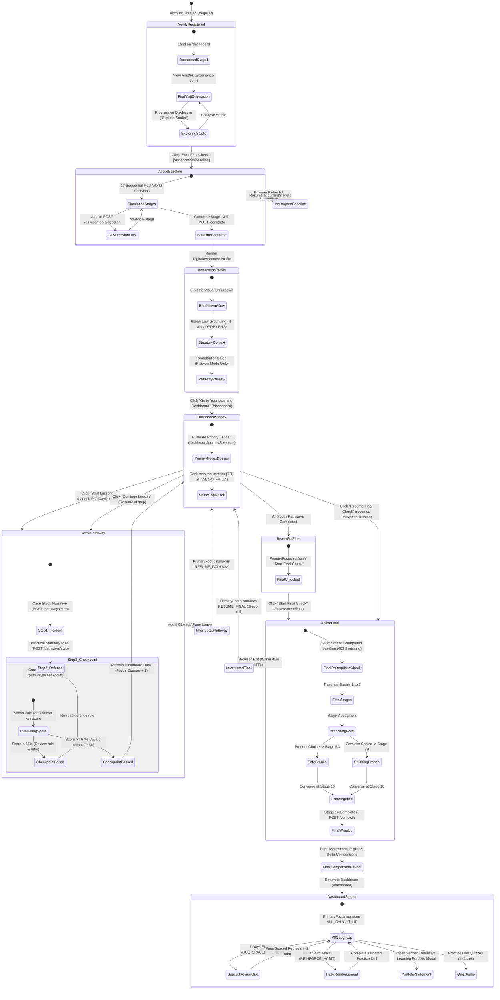

# System Architecture & Canonical Learner Journey

## 1. System Architecture Overview
The Cyber Law Awareness Portal is an academic, full-stack educational and diagnostic platform designed to evaluate and enhance digital security behavior and legal awareness under Indian Cyber Law (Information Technology Act 2000, Bharatiya Nyaya Sanhita 2023, Digital Personal Data Protection Act 2023).



---

## 2. Canonical Learner Journey State Machine

The following diagram defines the canonical state machine of a learner through the Cyber Law Awareness Portal:



---

## 3. The Six-Metric Behavioral Measurement Architecture

All assessment evaluations compute six Criterion-Referenced Behavioral Diagnostic Rubric normalized dimensions:

$$\text{Threat Recognition (TR)} = \left(\frac{\text{rawPoints}}{\text{maxOpportunities}}\right) \times 100$$

$$\text{Signal Identification (SI)} = \left(\frac{\text{rawPoints}}{\text{maxOpportunities}}\right) \times 100$$

$$\text{Verification Behavior (VB)} = \left(\frac{\text{rawPoints}}{\text{maxOpportunities}}\right) \times 100$$

$$\text{Decision Quality (DQ)} = \left(\frac{\text{rawPoints}}{\text{maxOpportunities}}\right) \times 100$$

$$\text{False Positive (FP)} = \max\left(0, 100 - \left(\frac{\text{penaltyPoints}}{\text{maxPenalty}}\right) \times 100\right)$$

$$\text{Unreviewed Acceptance (UA)} = \max\left(0, 100 - \left(\frac{\text{penaltyPoints}}{\text{maxPenalty}}\right) \times 100\right)$$

### Dynamic Traversal Denominators
Because Version 2 scenarios branch at Stage 7 (Stage 8A vs Stage 8B), maximum possible opportunities vary depending on the traversed path. Denominators are calculated dynamically based strictly on the stages actually encountered by the learner, guaranteeing mathematically valid normalizations ($0 \le \text{Score} \le 100$).

---

## 4. Authoritative Scoring & Prerequisite Enforcement

### Prerequisite State Machine (`simulationController.js`)
```javascript
// Server-authoritative check: Baseline prerequisite for Final Assessment
if (scenarioCode === 'final') {
  const completedBaseline = await AssessmentSession.findOne({
    userId: req.user._id,
    scenarioCode: 'baseline',
    status: 'completed'
  });

  if (!completedBaseline) {
    return res.status(403).json({
      success: false,
      code: 'PREREQUISITE_NOT_MET',
      message: 'You must complete the First Check (baseline assessment) before unlocking the Final Assessment.',
      prerequisiteUrl: '/assessment/baseline'
    });
  }
}
```

### Idempotent Resumption vs. Expiration Check
```javascript
// Active unexpired session resumption
const activeSession = await AssessmentSession.findOne({
  userId: req.user._id,
  scenarioCode,
  status: 'in-progress',
  expiresAt: { $gt: new Date() }
}).populate('currentStageId');

if (activeSession) {
  return res.json({
    success: true,
    sessionId: activeSession._id,
    resumed: true,
    stage: activeSession.currentStageId
  });
}
```

---

## 5. Replay Defense & CAS Concurrency

To defend against double-click attacks, race conditions, and replay submissions:
1. **Compare-And-Swap (CAS) Atomic Updates**:
   ```javascript
   const session = await AssessmentSession.findOneAndUpdate(
     { _id: sessionId, status: 'in-progress', currentStageId: stageId },
     { $set: { currentStageId: nextStageId, lastActivityAt: new Date() } },
     { new: true }
   );
   if (!session) throw new Error('Concurrent modification or stale stage.');
   ```
2. **Compound Unique Index**:
   `AssessmentDecision` enforces `{ assessmentSessionId: 1, stageId: 1 }`, guaranteeing that a decision for any single stage within an assessment session cannot be inserted more than once.

---

## 6. Pedagogical Boundaries & Data Separation

| Evidence Type | Backing Model | Measured Dimension | Displayed In UI |
| :--- | :--- | :--- | :--- |
| **Learning Interventions** | `UserProgress.completedPathways` | Completion of 3-step structured micro-curriculum | Dashboard Focus Count ("X of Y Completed") |
| **Knowledge Practice** | `QuizAttempt` | Cognitive understanding of statutory provisions & evidence standards | Quiz Studio, accuracy %, missed topic alerts |
| **Observed Behavioral Shifts** | `AssessmentSession` | Criterion-Referenced Behavioral Diagnostic Rubric judgment in high-fidelity simulated pressure scenarios | 6-metric profile, trajectory retention classification |
| **Targeted Habit Reinforcement** | `UserProgress.reinforcementsCompleted`| Post-final habit maintenance on confirmed deficits | Reinforcement drill records |
| **Untracked Reading** | Client `localStorage` / non-scored | Exploratory review of laws and cases | Reading checklist ticks |

Zero composite scores are generated or stored. Learning completion does not inflate behavioral scores, and quiz accuracy is never conflated with behavioral defense.

---

## 7. Statutory Accuracy & Emergency Guidance Architecture

### Legal Status Taxonomy
- `IN_FORCE`: Enforceable statutory provisions (IT Act 2000 §§ 43, 66, 66C, 66D; BNS 2023 §§ 318(4), 319; BSA 2023 § 63).
- `ENACTED_FUTURE_COMMENCEMENT`: Enacted legislation whose operational commencement is pending notification under G.S.R. 843(E) dated 13 November 2025. **DPDP Act 2023 §§ 6, 8, 11 are not yet in force as of 3 November 2026.** They are cited as upcoming legal standards, not active obligations.
- `STRUCK_DOWN_HISTORICAL`: Struck-down provisions (IT Act 2000 § 66A under *Shreya Singhal v. Union of India*) maintained strictly for historical and jurisprudential context.

### Emergency Cybercrime Reporting Guidance
- Immediate reporting is directed to the **National Cybercrime Helpline 1930** and official web portal **https://cybercrime.gov.in**.
- The Citizen Financial Cyber Fraud Reporting and Management System (CFCFRMS) facilitates inter-bank hold coordination; however, no promises of fixed recovery windows (e.g. 2–3 hours), guaranteed account freezes, or fund restitution are made.
