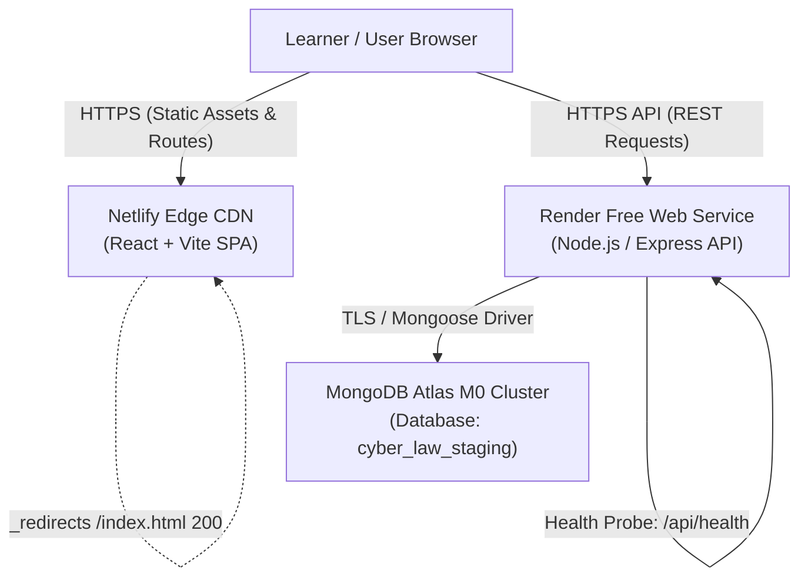

# Cyber Law Awareness Portal: Free-Tier Staging Deployment Guide

## 1. Architectural Overview & Free-Tier Topology

This guide details the step-by-step procedure to deploy the Cyber Law Awareness Portal to a zero-cost staging environment using:

| Tier Layer | Service Provider | Plan / Tier | Role | Estimated Cost |
| :--- | :--- | :--- | :--- | :--- |
| **Frontend** | **Netlify** | Starter (Free) | React 18 + Vite SPA hosting, global edge CDN, automated HTTPS | **₹0 / mo** |
| **Backend** | **Render** | Free Web Service | Node.js + Express API, TLS termination, automatic health checks | **₹0 / mo** |
| **Database** | **MongoDB Atlas** | M0 Sandbox (Free) | 512 MB storage, shared RAM, TLS 1.3 encryption, replica set | **₹0 / mo** |



---

## 2. Provider Free-Tier Limits & Operational Constraints

Deploying on free-tier services involves trade-offs that must be understood and planned for:

### 2.1 Render Free Web Service Constraints
1. **Inactivity Sleep / Spin-Down**:
   - Render spins down free Web Services after **15 minutes of inactivity**.
   - The first request after spin-down incurs a cold-start delay of **30 to 50 seconds** while the container boots and connects to MongoDB Atlas.
   - Subsequent requests execute at normal sub-second latencies while active.
2. **Monthly Free Hours**:
   - Render accounts receive **750 free instance hours per calendar month**, sufficient to run a single free service 24/7 (744 hours in a 31-day month).
3. **Outbound Dynamic IP Allocation (Crucial Atlas Networking Impact)**:
   - Render's free tier runs on shared AWS/GCP dynamic infrastructure. It does **not** provide static outbound IP addresses.
   - Consequently, MongoDB Atlas IP Access List cannot whitelist a single static IP for Render. Atlas Network Access must permit traffic from **Anywhere (`0.0.0.0/0`)**.
   - *Mitigation & Defense-in-Depth*: Access is strictly gated by strong username/password credentials, SCRAM-SHA-256 authentication, TLS/SSL transport encryption, and our fail-closed `ASSERT_STAGING_DB` guard.
4. **Ephemeral Local Storage**:
   - Render containers do not have persistent local disk storage. All file uploads or ephemeral assets in the local directory are wiped on container restart.
   - The Cyber Law Awareness Portal stores all curriculum, case studies, user progress, and assessment telemetry in MongoDB Atlas, so ephemeral container storage does not affect data durability.

### 2.2 Netlify Free Starter Tier
1. **Bandwidth & Build Minutes**:
   - 100 GB/month bandwidth and 300 build minutes/month. This is more than sufficient for staging validation.
2. **Single-Page Application (SPA) Routing**:
   - Netlify requires explicit rewrite configuration (`/* /index.html 200`) so that direct navigation or browser reload on routes like `/dashboard`, `/quizzes`, or `/laws` serves `index.html` rather than returning a 404. This is handled by `client/public/_redirects` and `netlify.toml`.

### 2.3 MongoDB Atlas M0 Sandbox
1. **Storage Limits**:
   - 512 MB total data storage. The Cyber Law Awareness Portal dataset (including 13 complete learning modules, 29 cyber crimes, 21 case studies, and 2,000+ quiz questions) uses under 15 MB, well within the 512 MB limit.
2. **Connection Limits**:
   - 500 concurrent connections. A single Render staging instance typically utilizes 5 to 15 pool connections.
3. **No Automated Backup Snapshots**:
   - M0 free clusters do not include continuous point-in-time recovery. Maintain offline JSON/JavaScript seed datasets (which already exist in `server/config/`).

---

## 3. Step-by-Step Provisioning Guide

### Step 3.1: Provision MongoDB Atlas Staging Database

1. Log in to [MongoDB Cloud](https://cloud.mongodb.com/).
2. Create or select a project (e.g., `CyberLaw-Staging`).
3. Click **Create Deployment** → Select **M0 (Free)**.
4. Select a cloud provider and region closest to your Render service (e.g., AWS `ap-south-1` Mumbai or AWS `eu-central-1` Frankfurt).
5. **Database User Setup**:
   - Go to **Security** → **Database Access** → **Add New Database User**.
   - Authentication Method: **Password**.
   - Set Username: `cyberlaw_staging_app`.
   - Autogenerate a secure password (minimum 24 characters). Save this securely.
   - Database User Privileges: Select **Specific Privileges** → Grant `readWrite` on the **`cyber_law_staging`** database only. Do not grant `atlasAdmin`.
6. **Network Access Setup**:
   - Go to **Security** → **Network Access** → **Add IP Address**.
   - Select **Allow Access From Anywhere (`0.0.0.0/0`)**.
   - Set Comment: `Render Free Tier Dynamic Ingress`.
7. **Obtain Connection String**:
   - In Database Deployments, click **Connect** → **Drivers** → **Node.js (version 5.5 or later)**.
   - Copy the SRV connection string:
     ```text
     mongodb+srv://cyberlaw_staging_app:<password>@<your-cluster>.mongodb.net/cyber_law_staging?retryWrites=true&w=majority
     ```
   - **Important**: Verify that the database name in the connection string path is strictly `cyber_law_staging`.

---

### Step 3.2: Provision Render Backend Web Service

1. Log in to [Render Dashboard](https://dashboard.render.com/).
2. Click **New +** → Select **Web Service**.
3. Connect your GitHub repository: `NightFury-boss/CyberLawAwarnessPortal`.
4. Configure service settings:
   - **Name**: `cyberlaw-portal-backend`
   - **Region**: Closest to your MongoDB Atlas region (e.g., Frankfurt or Oregon).
   - **Branch**: `stage-5-learning-consolidation` (or `main` after pull request merge).
   - **Root Directory**: `server`
   - **Runtime**: `Node`
   - **Build Command**: `npm install`
   - **Start Command**: `node server.js`
   - **Instance Type**: `Free`
5. **Advanced Settings**:
   - **Health Check Path**: `/api/health`
   - **Auto-Deploy**: `Yes`
6. **Environment Variables**:
   Under **Environment**, click **Add Environment Variable** and enter the following values:

   | Key | Value | Description |
   | :--- | :--- | :--- |
   | `NODE_ENV` | `production` | Enables Express production optimizations |
   | `HOST` | `0.0.0.0` | Binds to all interfaces inside the Render container |
   | `CLIENT_URL` | `https://<your-netlify-subdomain>.netlify.app` | Netlify frontend URL for CORS validation |
   | `MONGODB_URI` | `mongodb+srv://cyberlaw_staging_app:<pass>@.../cyber_law_staging?retryWrites=true&w=majority` | Atlas Staging URI |
   | `JWT_SECRET` | *(64-character high-entropy hex string)* | Generate using `openssl rand -hex 32` |
   | `TRUST_PROXY` | `1` | Enables trust for Render's single-hop TLS ingress |
   | `ASSERT_STAGING_DB` | `true` | Enforces fail-closed isolation guarding against production DBs |
   | `EXPECTED_STAGING_DB_NAME` | `cyber_law_staging` | Whitelists only this exact database name |
   | `SPACED_RETRIEVAL_DELAY_DAYS` | `7` | Spaced retrieval retention interval |
   | `SCORING_V2_CUTOVER_DATE` | `2026-11-04T00:00:00.000Z` | Scoring engine v2 cutover timestamp |
   | `RATE_LIMIT_AUTH_MAX` | `20` | Max auth attempts per window |
   | `RATE_LIMIT_AUTH_WINDOW_MS` | `900000` | 15-minute auth rate limit window |
   | `RATE_LIMIT_ASSISTANT_MAX` | `30` | Max assistant queries per window |
   | `RATE_LIMIT_ASSISTANT_WINDOW_MS` | `60000` | 1-minute assistant rate limit window |
   | `ADMIN_EMAIL` | `staging-admin@cyberlawportal.org` | Initial admin account email |
   | `ADMIN_PASSWORD` | *(Strong temporary staging admin password)* | Initial admin account password |

7. Click **Create Web Service**.
8. Wait for initial build to complete. Note your backend URL:
   `https://cyberlaw-portal-backend.onrender.com`

---

### Step 3.3: Provision Netlify Frontend Site

1. Log in to [Netlify Dashboard](https://app.netlify.com/).
2. Click **Add new site** → **Import an existing project** → **GitHub**.
3. Select `NightFury-boss/CyberLawAwarnessPortal`.
4. Configure build settings:
   - **Branch to deploy**: `stage-5-learning-consolidation` (or `main`)
   - **Base directory**: `client`
   - **Build command**: `npm run build`
   - **Publish directory**: `dist` (Netlify resolves this relative to the base directory as `client/dist`)
5. **Environment Variables**:
   Under **Site configuration** → **Environment variables**, add:

   | Key | Value | Description |
   | :--- | :--- | :--- |
   | `VITE_API_URL` | `https://cyberlaw-portal-backend.onrender.com/api` | Deployed Render backend API URL |

6. Click **Deploy Site**.
7. Note your assigned Netlify URL (e.g., `https://cyberlaw-portal-staging.netlify.app`).
8. **CORS Synchronization**:
   Copy your Netlify URL and update the `CLIENT_URL` environment variable in your **Render Web Service settings** to match this URL exactly. Render will automatically redeploy the backend with the new CORS origin.

---

## 4. Verification and Live Smoke Validation

Once both services are running and connected, execute the following verification steps:

### Check 1: Backend Health Probe
Open a browser or terminal and request the health endpoint:
```bash
curl -i https://cyberlaw-portal-backend.onrender.com/api/health
```
Expected response:
```http
HTTP/2 200
content-type: application/json; charset=utf-8
x-content-type-options: nosniff
x-frame-options: SAMEORIGIN
referrer-policy: strict-origin-when-cross-origin

{
  "status": "healthy",
  "database": "connected",
  "uptime": 42,
  "timestamp": "2026-11-11T04:00:00.000Z"
}
```

### Check 2: SPA Route Reload Check
In your browser:
1. Navigate to `https://<your-netlify-subdomain>.netlify.app/laws`.
2. Hard reload the page (`Ctrl + Shift + R` or `Cmd + Shift + R`).
3. Verify the Cyber Laws catalog renders correctly without a 404 "Page Not Found" error.

### Check 3: CORS Validation
Open browser developer tools on your Netlify frontend (`Console` and `Network` tabs):
1. Navigate to `/crimes` or `/cases`.
2. Verify API requests to `https://<your-render-backend>.onrender.com/api/crimes` return HTTP 200 with header:
   `Access-Control-Allow-Origin: https://<your-netlify-subdomain>.netlify.app`
3. Verify that no CORS errors appear in the browser console.

### Check 4: Assessment & Behavioral Scoring Walkthrough
1. Register a test user on staging: `staging-tester-01@test.org`.
2. Complete the Baseline Assessment.
3. Verify that server-authoritative scoring calculates all 6 dimensions (`TR`, `SI`, `VB`, `DQ`, `FP`, `UA`).
4. Verify the Learner's Space dashboard displays the updated baseline benchmark.

---

## 5. Rollback and Disaster Recovery

If an issue occurs during staging validation:

1. **Frontend Rollback**:
   In Netlify Site Dashboard → **Deploys** → select the previously passing deploy → click **Publish deploy**. Netlify rolls back instantly with zero downtime.
2. **Backend Rollback**:
   In Render Dashboard → **Deploys** → select previous successful commit deploy → click **Rollback to this deploy**.
3. **Database Reset (Staging Only)**:
   If test data needs to be cleared in the staging database, re-run the idempotent seed script via the staging environment using the staging MongoDB URI:
   ```bash
   node server/config/seed.js
   ```
   Our fail-closed guard ensures this command will immediately refuse to run against any database named `cyber_law_portal` or containing production keywords.
