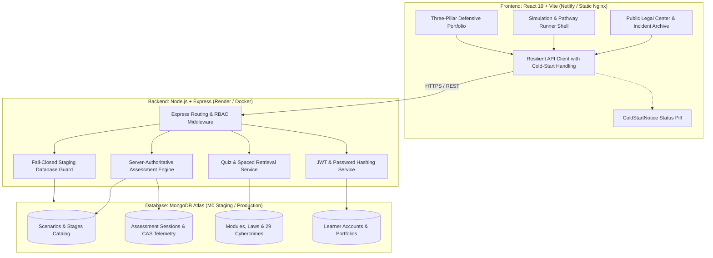

# System Architecture: Cyber Law Awareness Portal

The Cyber Law Awareness Portal is a full-stack educational web platform designed to transform statutory legal frameworks (Information Technology Act 2000, Digital Personal Data Protection Act 2023, Bharatiya Nyaya Sanhita 2023) into interactive threat simulations and measurable awareness assessments.

---

## 1. High-Level System Architecture

---

## 2. Core Architectural Pillars

### 2.1 Server-Authoritative Assessment Engine
- **Zero Client-Side Scoring**: The browser never computes assessment scores or decides behavioral outcomes. Clients submit stage decisions along with unique idempotency keys (`submitAssessmentStep`).
- **Six Discrete, Non-Composite Cognitive Dimensions**:
  1. `TR` (Threat Recognition): Ability to detect deceptive patterns, phishing vectors, and social engineering pressure.
  2. `SI` (Systematic Inspection): Careful inspection of URLs, sender addresses, technical headers, and transactional evidence before acting.
  3. `VB` (Verification Behavior): Verifying suspicious claims or requests independently through official or out-of-band channels.
  4. `DQ` (Deliberate Questioning): Pausing to challenge false urgency, coerced secrecy, or unverified authority before acting.
  5. `FP` (Fault Preparedness): Knowledge of corrective escalation steps, including National Helpline **1930** and CFCFRMS Golden Hour reporting within 2–3 hours (without assuming guaranteed recovery).
  6. `UA` (Uncertainty Acknowledgment): Recognizing evidentiary ambiguity, investigative limits, and uncertainty rather than making overconfident assumptions.
- **CAS & Idempotency Locking**: Submissions utilize optimistic concurrency control (Compare-and-Swap). If a network retry occurs or duplicate clicks arrive, the engine checks the `idempotencyKey` and session version, returning the existing recorded evaluation without duplicate state mutation.

### 2.2 Cold-Start & API Timeout Strategy
- **Render Free-Tier Spin-Down Awareness**: Free containers spin down after 15 minutes of inactivity.
- **Adaptive Timeouts**:
  - Cold Start Timeout: 60 seconds (active during staging initial spin-up).
  - Standard Timeout: 15 seconds (active once container responds or in production).
- **Single-Boundary Lifecycle Tracking**: In-flight requests are tracked outside the retry loop to eliminate UI banner flicker.
- **Status Code-Aware Awake State**: HTTP 502, 503, and 504 proxy responses do not mark the container awake, preserving 60s timeout resilience.
- **Strict Non-Retrying Mutations**: Mutating operations (`POST`, `PUT`, `PATCH`, `DELETE`) are strictly non-retrying (`maxRetries = 0`). Only read-only idempotent `GET` and `HEAD` requests may retry once with backoff during cold starts.
- **Transparent Signal Propagation**: Combines caller-supplied `AbortSignal` with timeout timers, ensuring immediate cancellation when components unmount or learners navigate away.

### 2.3 Fail-Closed Staging Database Guard
- **Namespace Whitelisting**: The application enforces `ASSERT_STAGING_DB=true`.
- **Keyword Rejection**: Any connection URI targeting databases containing `prod`, `production`, `live`, or `master` immediately triggers a fatal error, halting server startup before opening a TCP socket.
- **Approved Namespaces**: Strictly permits `cyber_law_staging` during staging operations.

---

## 3. Directory Responsibilities

- **`client/`**: React 19 single-page application built with Vite.
  - `src/components/layout/`: Global navigation, drawer sidebar, and editorial footer.
  - `src/components/common/`: Shared UI components including `ColdStartNotice` and `BrandLogo`.
  - `src/components/assessment/`: Simulation runners and defensive portfolio visualizers.
  - `src/pages/`: 17 routed page views.
  - `src/services/api.js`: Unified API service client.
- **`server/`**: Express REST API server.
  - `config/`: Security, staging guards, database connection, and seed datasets.
  - `controllers/`: Route handlers and response serialization.
  - `middleware/`: Authentication, rate limiting, and CORS enforcement.
  - `models/`: Mongoose schemas for Users, Scenarios, Sessions, Laws, and Crimes.
  - `services/`: Scoring engines, spaced retrieval, and portfolio trajectory calculations.
  - `tests/`: 71+ automated unit and integration tests.
- **`docs/`**: Comprehensive project documentation, deployment runbooks, audits, and legal research packages.
- **`scripts/`**: Operational deployment utilities, database verification harnesses, and diagnostic scripts.

---

## 4. Domain Models & Interactive State Machines

*(Preserved and formalized from the project blueprint `PROJECT_SPEC.md`)*

### 4.1 Experiential Pedagogical Workflow
The portal transforms static legal text into an experiential educational loop:
$$\text{Experience (Threat Simulation)} \longrightarrow \text{Understand (Warning Signs)} \longrightarrow \text{Learn (Applicable Statutes)} \longrightarrow \text{Practice (Topic Quizzes)} \longrightarrow \text{Improve (Defensive Portfolio)}$$

### 4.2 Interactive State Machines

#### A. The "Law Compass" Audit Wizard (`Laws.jsx`)
An interactive situation audit wizard mapping real-world user dilemmas to applicable statutory provisions:
- **State Progression**: `selectedCompassCategory` ➔ `compassStep` ➔ `selectedOption` ➔ `wizardFeedback`.
- **Workflow**:
  1. Learner selects an operational category (e.g. Identity Theft, Financial Fraud, Digital Harassment).
  2. The system loads situational assessment questions linked to statutory sections.
  3. Learner submits an option; the engine evaluates correctness, presents an editorial legal explanation, and provides direct navigation to the governing statutory card.

#### B. Incident Decision Pauses (`Cases.jsx`)
Investigative case reconstructions featuring controlled narrative pauses:
- **Lock Logic**: The narrative progress halts before the final incident outcome is revealed, placing the learner in the victim's or investigator's position:
  $$\text{showSection} = (\text{index} < \max(1, \text{totalSections} - 2)) \lor \text{narrativeUnlocked}$$
- **Unlock Path**: Learner selects an action at the critical decision point ➔ system evaluates procedural quality and records feedback ➔ learner activates *"Audit Outcome"* ➔ sets `narrativeUnlocked = true` ➔ the full aftermath, investigation timeline, and statutory citations fade in.
- **Incident Path Stage Sequence (SVG)**: Dynamic 5-stage visual trace:
  $$\text{1. BAIT} \longrightarrow \text{2. LEVERAGE} \longrightarrow \text{3. CHOICE} \longrightarrow \text{4. IMPACT} \longrightarrow \text{5. LAW}$$

### 4.3 Core Domain Schema Contracts

1. **`LawSection` (`server/models/LawSection.js`)**:
   - `slug`: Unique kebab-case identifier.
   - `sectionNumber`: Primary statutory clause (e.g. "Section 66C", "Section 43").
   - `legalStatus`: Enum (`CURRENT`, `OMITTED`, `REPEALED`, `AMENDED`, `PROPOSED`, `TEMPORARILY_SUSPENDED`, `NOT_YET_IN_FORCE`, `UNDER_REVIEW`).
   - `officialText` & `plainEnglishText`: Side-by-side statutory language and plain-language interpretation.
   - `scenarioCompass`: Embedded audit questions and option mappings.
2. **`CyberCrime` (`server/models/CyberCrime.js`)**:
   - `slug`, `title`, `category`, `redFlagLevel`.
   - `warningSigns`: Explicit behavioral warning signs.
   - `spotRedFlags`: Interactive text inspection challenge with flaggable segments and explanations.
3. **`CaseStudy` (`server/models/CaseStudy.js`)**:
   - `slug`, `caseNumber`, `caseType`, `attackVector`, `incidentType`.
   - `narrativeSections`: 6-part structured narrative sections with required headings and body text.
   - `decisionPoints`: Situational pause choices with corrective feedback.
   - `timeline`: Chronological event log with typed event nodes (`contact`, `deception`, `decision`, `escalation`, `discovery`).
   - `sources`: Verifiable judicial records, High Court/Supreme Court citations, and document types.
