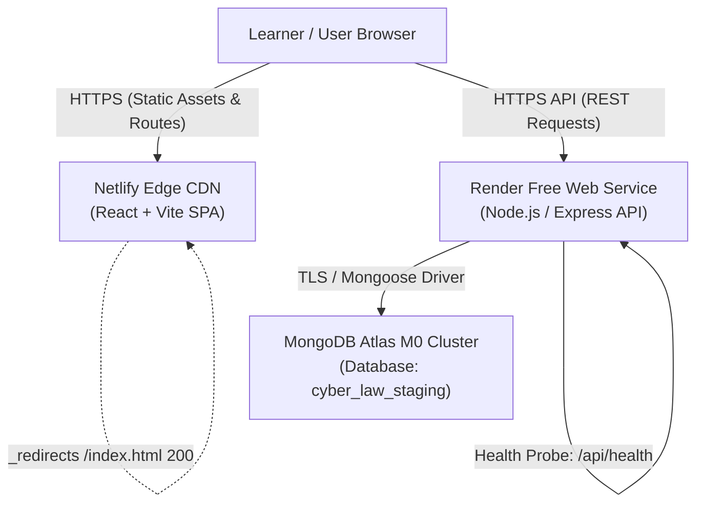
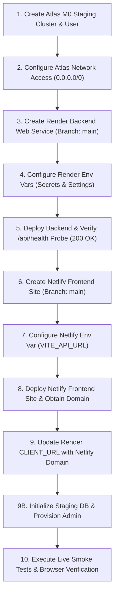

# Cyber Law Awareness Portal: Free-Tier Staging Deployment Guide

## 1. Architectural Overview & Free-Tier Topology

This guide details the step-by-step procedure to deploy the Cyber Law Awareness Portal to a zero-cost staging environment using:

| Tier Layer | Service Provider | Plan / Tier | Role | Estimated Cost |
| :--- | :--- | :--- | :--- | :--- |
| **Frontend** | **Netlify** | Starter (Free) | React 18 + Vite SPA hosting, global edge CDN, automated HTTPS | **₹0 / mo** |
| **Backend** | **Render** | Free Web Service | Node.js + Express API, TLS termination, automatic health checks | **₹0 / mo** |
| **Database** | **MongoDB Atlas** | M0 Sandbox (Free) | 512 MB storage, shared RAM, TLS 1.3 encryption, replica set | **₹0 / mo** |



---

## 2. Provider Free-Tier Limits & Operational Constraints

Deploying on free-tier services involves trade-offs that must be understood and planned for:

### 2.1 Render Free Web Service Constraints
1. **Inactivity Sleep / Spin-Down**:
   - Render spins down free Web Services after **15 minutes of inactivity**.
   - The first request after spin-down incurs a cold-start delay of **30 to 50 seconds** while the container boots and establishes connection to MongoDB Atlas.
   - Subsequent requests execute at normal sub-second latencies while active.
2. **Monthly Free Hours**:
   - Render accounts receive **750 free instance hours per calendar month**, sufficient to run a single free service 24/7 (744 hours in a 31-day month).
   - If multiple free web services share one Render account, monthly hours are pooled and may be exhausted before month's end.
3. **Outbound Dynamic IP Allocation**:
   - Render's free tier runs on shared AWS/GCP dynamic infrastructure. It does **not** provide static outbound IP addresses. Egress IPs rotate across container restarts and rescheduling events.
   - Consequently, MongoDB Atlas IP Access List cannot whitelist a single static IP for Render. See Section 2.3 and Section 3.1 for comprehensive risk analysis and mandatory isolation rules.
4. **Ephemeral Local Storage**:
   - Render containers do not provide persistent local disk storage. Any ephemeral files in the local container filesystem are wiped on container restart.
   - The Cyber Law Awareness Portal stores all curriculum, case studies, user progress, and assessment telemetry in MongoDB Atlas, so ephemeral container storage does not affect data durability.
5. **Automatic Deployments (`autoDeploy: true`)**:
   - The repository blueprint (`render.yaml`) configures `autoDeploy: true`.
   - **Important**: Any push or pull request merge directly into the `main` branch on GitHub will automatically trigger a new build and deployment on Render.
   - *Operational note*: Developers should coordinate merges to `main` so that unfinished changes are not prematurely published to the staging backend.

### 2.2 Netlify Free Starter Tier
1. **Bandwidth & Build Minutes**:
   - 100 GB/month bandwidth and 300 build minutes/month, well beyond staging evaluation requirements.
2. **Single-Page Application (SPA) Routing**:
   - Netlify requires explicit rewrite configuration (`/* /index.html 200`) so that direct navigation or browser reload on routes like `/dashboard`, `/quizzes`, or `/laws` serves `index.html` rather than returning a 404. This is handled by both `client/public/_redirects` and `netlify.toml`.
3. **Default Subdomain Environment Heuristics (`*.netlify.app`)**:
   - The portal client uses deterministic environment detection (`isStagingEnvironment()`). By default, hostnames containing `netlify.app` or `staging` match the staging heuristic to provide staging cold-start notices and adaptive 60s cold-start timeouts.
   - **Crucial Production Requirement**: Any production site hosted on a default `*.netlify.app` subdomain (without a custom domain) MUST explicitly set `VITE_APP_ENV=production` in Netlify Site Configuration. Explicit `VITE_APP_ENV=production` always takes absolute precedence over hostname heuristics, ensuring neutral user messages and standard production timeouts.

### 2.3 MongoDB Atlas M0 Sandbox & Network Access Risk Reality
1. **Storage & Connection Limits**:
   - 512 MB total data storage. The Cyber Law Awareness Portal dataset (including 13 learning modules, 29 cyber crimes, 21 case studies, and full question catalogs) occupies less than 15 MB.
   - Maximum 500 concurrent connections. A single Render staging instance typically utilizes 5 to 15 pool connections.
2. **No Automated Backup Snapshots**:
   - M0 free clusters do not include continuous point-in-time recovery. Maintain offline JSON/JavaScript seed datasets (which already exist in `server/config/`).
3. **Comprehensive Risk Assessment for Permitting Anywhere (`0.0.0.0/0`)**:
   - **What Allowing `0.0.0.0/0` Means**:
     Adding `0.0.0.0/0` to the Atlas Network Access IP Access List instructs the MongoDB Atlas firewall to accept incoming TCP traffic on port 27017 from any IPv4 address globally across the public internet.
   - **Why It Is Required for This Free Architecture**:
     Render's Free Web Service tier runs on multi-tenant, dynamically scheduled container infrastructure without static egress IP addresses. Render does not publish a predictable CIDR block for free containers. Whitelisting a specific IP or small subnet is technically impossible on Render Free.
   - **Increased Attack Surface**:
     Opening port 27017 to the public internet exposes the database cluster listener to:
     * Global automated port scanners and botnets looking for exposed MongoDB instances.
     * Targeted brute-force and credential-stuffing attacks.
     * Denial-of-service (DoS) attempts that could consume Atlas M0's 500 connection limit, rendering the database unresponsive to Render.
     * Potential zero-day vulnerabilities in MongoDB's network protocol stack.
   - **Why Authentication and TLS Do Not Eliminate All Risk**:
     * TLS 1.3 encrypts traffic in transit, preventing eavesdropping and tampering.
     * SCRAM-SHA-256 enforces robust cryptographic authentication.
     * However, TLS and authentication only protect queries *after* a connection handshake begins. They do not mitigate network-level connection exhaustion (DoS), connection flooding, or brute-force authentication load on cluster CPU.
   - **Mandatory Safeguards to Enforce**:
     * **Zero Production Data Rule**: The staging database (`cyber_law_staging`) MUST NEVER contain real user PII, real contact details, actual production secrets, or live case records. It is strictly a sanitized testing sandbox.
     * **Granular Least-Privilege User**: The Atlas database user (`cyberlaw_staging_app`) MUST be granted `readWrite` strictly on the single database `cyber_law_staging`. It must NEVER be assigned `atlasAdmin`, `readWriteAnyDatabase`, cluster monitor, or permissions on any other database namespace.
     * **High-Entropy Password**: The password for `cyberlaw_staging_app` must be an unguessable, randomly generated string of at least 24+ characters (including uppercase, lowercase, numbers, and symbols).
     * **Fail-Closed Application Guard**: The portal codebase enforces `ASSERT_STAGING_DB=true` and `EXPECTED_STAGING_DB_NAME=cyber_law_staging`. If a connection string accidentally references `cyber_law_portal` or any database containing prohibited keywords (`prod`, `production`, `live`, `master`, `primary`), the server immediately throws a fatal exception and aborts startup before opening a socket.
   - **Safer Production Alternatives (Beyond Free Tier)**:
     If the application moves to a production or funded staging plan:
     * **Render Team Tier with Static Outbound IP**: Render Team/Enterprise plans provide dedicated static outbound IPs ($29+/month) that allow Atlas to whitelist exact `/32` IPs.
     * **VPC Peering / AWS PrivateLink**: Atlas Dedicated clusters (M10+) support VPC Peering or AWS PrivateLink, allowing Render or AWS services to communicate with Atlas via private internal networking without traversing the public internet.

---

## 3. Definitive Environment-Variable Checklist

The table below reflects the exact configuration variables verified against the current codebase:

| Variable | Target Service | Required? | Nature | Expected Format / Value | Default / Fallback in Code | Relevant Source File |
| :--- | :--- | :--- | :--- | :--- | :--- | :--- |
| `NODE_ENV` | Render | Optional | Config | `production` | None (Node default) | `server/server.js:13`, `render.yaml:18` |
| `HOST` | Render | Optional | Config | `0.0.0.0` | `'0.0.0.0'` | `server/server.js:132`, `render.yaml:20` |
| `PORT` | Render | Optional | Config | Auto-injected by Render (e.g. `10000`) | `5000` | `server/server.js:131` |
| `CLIENT_URL` | Render | **Required** in prod | Config | `https://<site-name>.netlify.app` (or comma-separated HTTPS origins) | Throws fatal error in prod; `'http://localhost:5173'` in dev | `server/config/productionSecurity.js:76`, `server/server.js:53` |
| `MONGODB_URI` | Render | **Required** | Secret | `mongodb+srv://cyberlaw_staging_app:<pass>@<cluster>.mongodb.net/cyber_law_staging?retryWrites=true&w=majority` | Checks `MONGO_URI`, then `'mongodb://localhost:27017/cyber_law_portal'` | `server/config/db.js:7`, `render.yaml:42` |
| `MONGO_URI` | Render | Optional | Secret | Alternative database URI fallback | None | `server/config/db.js:7` |
| `JWT_SECRET` | Render | **Required** in prod | Secret | 64-hex char string (min 32 chars, high entropy) | Throws fatal error in prod; dev placeholder in dev/test | `server/config/productionSecurity.js:34`, `render.yaml:44` |
| `TRUST_PROXY` | Render | Optional | Config | `'1'` (or `'true'`) | `'1'` | `server/server.js:35`, `render.yaml:22` |
| `ASSERT_STAGING_DB` | Render | **Required** for staging | Config | `'true'` | Unset (guard bypassed if not `'true'`) | `server/config/db.js:8`, `render.yaml:24` |
| `EXPECTED_STAGING_DB_NAME` | Render | Optional | Config | `cyber_law_staging` | Unset (falls back to broad staging whitelist) | `server/config/stagingDatabaseGuard.js:126`, `render.yaml:26` |
| `SPACED_RETRIEVAL_DELAY_DAYS` | Render | Optional | Config | Positive integer string (e.g. `'7'`) | `7` | `server/services/spacedRetrievalService.js:20`, `render.yaml:28` |
| `SCORING_V2_CUTOVER_DATE` | Render | **Required** in prod | Config | ISO 8601 UTC timestamp: `'2026-11-04T00:00:00.000Z'` | Throws `CONFIG_CUTOVER_MISSING` in prod; `'2026-11-04T00:00:00.000Z'` in test | `server/config/cutoverConfig.js:8`, `render.yaml:30` |
| `RATE_LIMIT_AUTH_MAX` | Render | Optional | Config | Positive integer string (e.g. `'20'`) | `20` | `server/middleware/rateLimitMiddleware.js:111`, `render.yaml:32` |
| `RATE_LIMIT_AUTH_WINDOW_MS` | Render | Optional | Config | Integer milliseconds string (e.g. `'900000'`) | `900000` (15 minutes) | `server/middleware/rateLimitMiddleware.js:110`, `render.yaml:34` |
| `RATE_LIMIT_ASSISTANT_MAX` | Render | Optional | Config | Positive integer string (e.g. `'30'`) | `30` | `server/middleware/rateLimitMiddleware.js:117`, `render.yaml:36` |
| `RATE_LIMIT_ASSISTANT_WINDOW_MS`| Render | Optional | Config | Integer milliseconds string (e.g. `'60000'`) | `60000` (1 minute) | `server/middleware/rateLimitMiddleware.js:116`, `render.yaml:38` |
| `ADMIN_EMAIL` | Render | Optional | Secret | Email string (e.g. `staging-admin@cyberlawportal.org`) | `'admin@cyberlawportal.test'` (seed script fallback) | `server/config/seed.js:54`, `render.yaml:46` |
| `ADMIN_PASSWORD` | Render | Optional | Secret | Strong password string | `'AdminPass123!'` (seed script fallback) | `server/config/seed.js:55`, `render.yaml:48` |
| `VITE_API_URL` | Netlify | Optional | Public | `https://<backend>.onrender.com/api` (or `/api`) | `resolveApiUrl()` normalizes slashes, defaults to window origin or `http://localhost:5000/api` | `client/src/services/api.js:11` |
| `VITE_APP_ENV` | Netlify | **Required** in prod on `*.netlify.app` | Config | `'production'` or `'staging'` | Unset (falls back to hostname / URL heuristics) | `client/src/services/api.js:62` |
| `VITE_IS_STAGING` | Netlify | Optional | Config | `'true'` or `'false'` | Unset | `client/src/services/api.js:66` |
| `VITE_API_TIMEOUT_MS` | Netlify | Optional | Config | Integer milliseconds string (e.g. `'15000'`) | `15000` (15s default active timeout) | `client/src/services/api.js:96` |
| `VITE_API_COLD_START_TIMEOUT_MS` | Netlify | Optional | Config | Integer milliseconds string (e.g. `'60000'`) | `60000` (60s cold-start timeout) | `client/src/services/api.js:97` |

> [!IMPORTANT] Production on Default `*.netlify.app` Subdomains
> Production deployments hosted on default `*.netlify.app` subdomains (without a custom domain like `cyberlawportal.in`) will match the client's automated staging heuristic (`loc.hostname.includes('netlify.app')`) unless explicitly overridden. To ensure production sites on `*.netlify.app` run with production timeouts and neutral messaging (never displaying staging-specific notices or Render cold-start explanations), you MUST set `VITE_APP_ENV=production` in the Netlify site configuration (Site configuration > Environment variables). Explicit `VITE_APP_ENV=production` always takes absolute precedence over hostname heuristics.

---

## 4. Health-Check Endpoint Specification & Limitations

The `/api/health` probe is implemented in `server/server.js` (lines 97–108).

### 4.1 Implementation & Response Contract
```javascript
app.get('/api/health', (req, res) => {
  const isDbConnected = mongoose.connection.readyState === 1;
  const status = isDbConnected ? 'healthy' : 'degraded';
  const statusCode = isDbConnected ? 200 : 503;

  res.status(statusCode).json({
    status,
    database: isDbConnected ? 'connected' : 'disconnected',
    uptime: Math.floor(process.uptime()),
    timestamp: new Date().toISOString()
  });
});
```

- **Database Connected (`readyState === 1`)**:
  * HTTP Status: `200 OK`
  * Body:
    ```json
    {
      "status": "healthy",
      "database": "connected",
      "uptime": 128,
      "timestamp": "2026-11-11T05:00:00.000Z"
    }
    ```
- **Database Disconnected (`readyState !== 1`)**:
  * HTTP Status: `503 Service Unavailable`
  * Body:
    ```json
    {
      "status": "degraded",
      "database": "disconnected",
      "uptime": 12,
      "timestamp": "2026-11-11T05:00:00.000Z"
    }
    ```

### 4.2 Endpoint Limitations
1. **Shallow State Check**:
   - The probe evaluates the in-memory state of the Mongoose connection (`mongoose.connection.readyState === 1`).
   - It does **not** execute an active round-trip ping query (`db.admin().ping()`) or test collection read/write capabilities on Atlas.
2. **Resource Isolation**:
   - It does not measure memory pressure, container CPU saturation, or disk utilization.
3. **Third-Party Services**:
   - It does not check upstream external network connections.
4. **Purpose**:
   - Designed strictly as a lightweight, zero-overhead liveness and readiness probe for Render's container health monitor without introducing connection pool overhead or triggering database rate limits.

---

## 5. Dependency-Aware 10-Step Provisioning Procedure

Follow this strict dependency-aware provisioning sequence:



### Step 1: Provision MongoDB Atlas Staging Database & Least-Privilege User
1. Log in to [MongoDB Cloud](https://cloud.mongodb.com/).
2. Create or select a project (e.g., `CyberLaw-Staging`).
3. Click **Create Deployment** → Select **M0 (Free)**.
4. Select a cloud provider and region closest to your Render service (e.g., AWS `ap-south-1` Mumbai or AWS `eu-central-1` Frankfurt).
5. **Database User Setup (Crucial Least-Privilege Constraint)**:
   - Navigate to **Security** → **Database Access** → **Add New Database User**.
   - Authentication Method: **Password**.
   - Set Username: `cyberlaw_staging_app`.
   - Autogenerate a secure password of **at least 24 characters**. Save this securely.
   - Database User Privileges: Select **Specific Privileges** → Grant `readWrite` on the **`cyber_law_staging`** database only. Do not grant `atlasAdmin` or cluster-level roles.
6. Click **Add User**.

### Step 2: Configure Atlas Network Access
1. Navigate to **Security** → **Network Access** → **Add IP Address**.
2. Select **Allow Access From Anywhere (`0.0.0.0/0`)**.
3. Set Comment: `Render Free Tier Dynamic Ingress`.
4. Review the risk assessment in Section 2.3 and ensure the database name is strictly `cyber_law_staging`.
5. Obtain Connection String:
   - Under Database Deployments, click **Connect** → **Drivers** → **Node.js (version 5.5 or later)**.
   - Copy the SRV connection URI:
     ```text
     mongodb+srv://cyberlaw_staging_app:<password>@<your-cluster>.mongodb.net/cyber_law_staging?retryWrites=true&w=majority
     ```
   - Verify that the path component ends with `/cyber_law_staging`.

### Step 3: Create Render Backend Web Service from `main`
1. Log in to [Render Dashboard](https://dashboard.render.com/).
2. Click **New +** → Select **Web Service**.
3. Connect the GitHub repository: `NightFury-boss/CyberLawAwarnessPortal`.
4. Configure service settings:
   - **Name**: `cyberlaw-portal-backend`
   - **Region**: Nearest to your Atlas cluster (e.g., Frankfurt or Oregon).
   - **Branch**: **`main`** *(Deployments must strictly use the reviewed, merged `main` branch)*.
   - **Root Directory**: `server`
   - **Runtime**: `Node`
   - **Build Command**: `npm install`
   - **Start Command**: `node server.js`
   - **Instance Type**: `Free`
5. Under **Advanced Settings**:
   - **Health Check Path**: `/api/health`
   - **Auto-Deploy**: `Yes` (noting that pushes to `main` auto-trigger deployments).

### Step 4: Configure Render Environment Variables
Under **Environment**, click **Add Environment Variable** and enter the verified values:

- `NODE_ENV`: `production`
- `HOST`: `0.0.0.0`
- `TRUST_PROXY`: `1`
- `ASSERT_STAGING_DB`: `true`
- `EXPECTED_STAGING_DB_NAME`: `cyber_law_staging`
- `SPACED_RETRIEVAL_DELAY_DAYS`: `7`
- `SCORING_V2_CUTOVER_DATE`: `2026-11-04T00:00:00.000Z`
- `RATE_LIMIT_AUTH_MAX`: `20`
- `RATE_LIMIT_AUTH_WINDOW_MS`: `900000`
- `RATE_LIMIT_ASSISTANT_MAX`: `30`
- `RATE_LIMIT_ASSISTANT_WINDOW_MS`: `60000`
- `MONGODB_URI`: *(Your Atlas SRV URI from Step 2)*
- `JWT_SECRET`: *(Generate via `openssl rand -hex 32` - minimum 64 hex characters)*
- `CLIENT_URL`: Enter a temporary placeholder (e.g. `https://placeholder.netlify.app`) or wait for Step 8.
- `ADMIN_EMAIL`: `staging-admin@cyberlawportal.org` *(Optional, used during seed)*
- `ADMIN_PASSWORD`: *(Strong staging admin password, used during seed)*

### Step 5: Deploy Backend & Verify Health Probe
1. Click **Create Web Service**.
2. Wait for the initial build and container startup to complete.
3. Note your assigned Render backend URL:
   `https://cyberlaw-portal-backend.onrender.com`
4. Test the health probe using curl:
   ```bash
   curl -i https://cyberlaw-portal-backend.onrender.com/api/health
   ```
5. Confirm HTTP 200 response with `{"status":"healthy","database":"connected"}`.

### Step 6: Create Netlify Frontend Site from `main`
1. Log in to [Netlify Dashboard](https://app.netlify.com/).
2. Click **Add new site** → **Import an existing project** → **GitHub**.
3. Select `NightFury-boss/CyberLawAwarnessPortal`.
4. Configure build settings:
   - **Branch to deploy**: **`main`**
   - **Base directory**: `client`
   - **Build command**: `npm run build`
   - **Publish directory**: `dist` (interpreted by Netlify as `client/dist`)

### Step 7: Configure Netlify Environment Variables
Under **Site configuration** → **Environment variables**, configure:
- **For Staging Deployments**:
  - `VITE_API_URL`: `https://cyberlaw-portal-backend.onrender.com/api`
  - `VITE_APP_ENV`: `staging` *(Optional: hostnames with `netlify.app` or `staging` automatically detect as staging)*
- **For Production Deployments Hosted on Default `*.netlify.app` Subdomains**:
  - `VITE_API_URL`: `https://api.cyberlawportal.org/api` *(or your production backend URL)*
  - `VITE_APP_ENV`: `production` *(**Mandatory** when using default `*.netlify.app` subdomains to prevent accidental staging heuristics)*

### Step 8: Deploy Netlify Frontend Site
1. Click **Deploy Site**.
2. Wait for Vite build to complete (typically ~30–60 seconds).
3. Copy your assigned Netlify production URL (e.g., `https://cyberlaw-portal-staging.netlify.app`).

### Step 9: Synchronize CORS Origin in Render
1. Return to the [Render Dashboard](https://dashboard.render.com/) → `cyberlaw-portal-backend` → **Environment**.
2. Update `CLIENT_URL` to the exact Netlify URL from Step 8:
   `CLIENT_URL = https://cyberlaw-portal-staging.netlify.app`
3. Click **Save Changes**. Render will automatically trigger a zero-downtime redeployment with the new CORS policy.

### Step 9B: Initialize Staging Database & Provision Administrator *(Required Before Smoke / Browser Walkthroughs)*
Before testing assessments or logging into Admin on a fresh `cyber_law_staging` database:
1. Run offline dry-run and live guarded canonical initialization from a trusted shell with explicit staging env vars (`ASSERT_STAGING_DB=true`, `EXPECTED_STAGING_DB_NAME=cyber_law_staging`, `EXPECTED_STAGING_HOST`, `MONGODB_URI`):
   ```bash
   node scripts/initializeStagingDatabase.js --live-dry-run
   node scripts/initializeStagingDatabase.js --confirm --execute
   ```
2. Provision the staging administrator account using the dedicated admin provisioner (with `ADMIN_EMAIL` and `ADMIN_PASSWORD` set):
   ```bash
   node scripts/createStagingAdmin.js --dry-run
   node scripts/createStagingAdmin.js --confirm --execute
   ```
3. Verify `/api/laws` and `/api/quizzes` return initialized canonical records before running Check 4's assessment walkthrough.

### Step 10: Execute Live Smoke Tests & Verification
Execute the checks described in Section 6 below only after database initialization and admin provisioning succeed.

---

## 6. Live Smoke Verification & Validation Checklist

Once both services are running and connected, execute the following verification steps:

### Check 1: Backend Health Probe
```bash
curl -i https://cyberlaw-portal-backend.onrender.com/api/health
```
Expected output:
```http
HTTP/2 200
content-type: application/json; charset=utf-8
x-content-type-options: nosniff
x-frame-options: SAMEORIGIN
referrer-policy: strict-origin-when-cross-origin

{
  "status": "healthy",
  "database": "connected",
  "uptime": 42,
  "timestamp": "2026-11-11T05:00:00.000Z"
}
```

### Check 2: SPA Route Hard-Reload Check
In your browser:
1. Navigate to `https://<your-netlify-subdomain>.netlify.app/laws`.
2. Hard reload the page (`Ctrl + Shift + R` or `Cmd + Shift + R`).
3. Verify that the Cyber Laws catalog renders correctly without a 404 "Page Not Found" error.
4. Repeat for `/quizzes`, `/crimes`, and `/cases`.

### Check 3: Production CORS Origin Validation
In browser Developer Tools (`Network` and `Console` tabs):
1. Navigate to `/crimes`.
2. Inspect the API network request to `https://<your-render-backend>.onrender.com/api/crimes`.
3. Verify the response contains:
   `Access-Control-Allow-Origin: https://<your-netlify-subdomain>.netlify.app`
4. Confirm no CORS violation warnings appear in the console.

### Check 4: Assessment & Behavioral Scoring Walkthrough
1. Register a test staging user: `staging-tester-01@test.org`.
2. Complete the Baseline Assessment.
3. Verify that server-authoritative scoring calculates all 6 dimensions (`TR`, `SI`, `VB`, `DQ`, `FP`, `UA`).
4. Verify the Learner's Space dashboard displays the updated baseline benchmark.

### Check 5: Render Spin-Down & Cold-Start Observation
1. Allow the staging environment to idle for 20 minutes without sending traffic.
2. In a browser, open `https://<your-netlify-subdomain>.netlify.app/laws`.
3. Observe the initial 30–50 second cold-start delay while Render wakes the container.
4. Confirm that once the container responds, subsequent navigation runs with instant response times.

---

## 7. Rollback and Disaster Recovery

If an issue occurs during staging validation:

1. **Frontend Instant Rollback**:
   In Netlify Site Dashboard → **Deploys** → select the previously passing deploy → click **Publish deploy**. Netlify rolls back instantly with zero downtime.
2. **Backend Rollback**:
   In Render Dashboard → **Deploys** → select the previous successful commit deploy → click **Rollback to this deploy**.
3. **Database Reset (Staging Only)**:
   If test data needs to be cleared in the staging database, re-run the idempotent seed script via the staging environment using the staging MongoDB URI:
   ```bash
   node server/config/seed.js
   ```
   Our fail-closed guard (`ASSERT_STAGING_DB=true`) ensures this command immediately refuses to run against any database named `cyber_law_portal` or containing production keywords.
